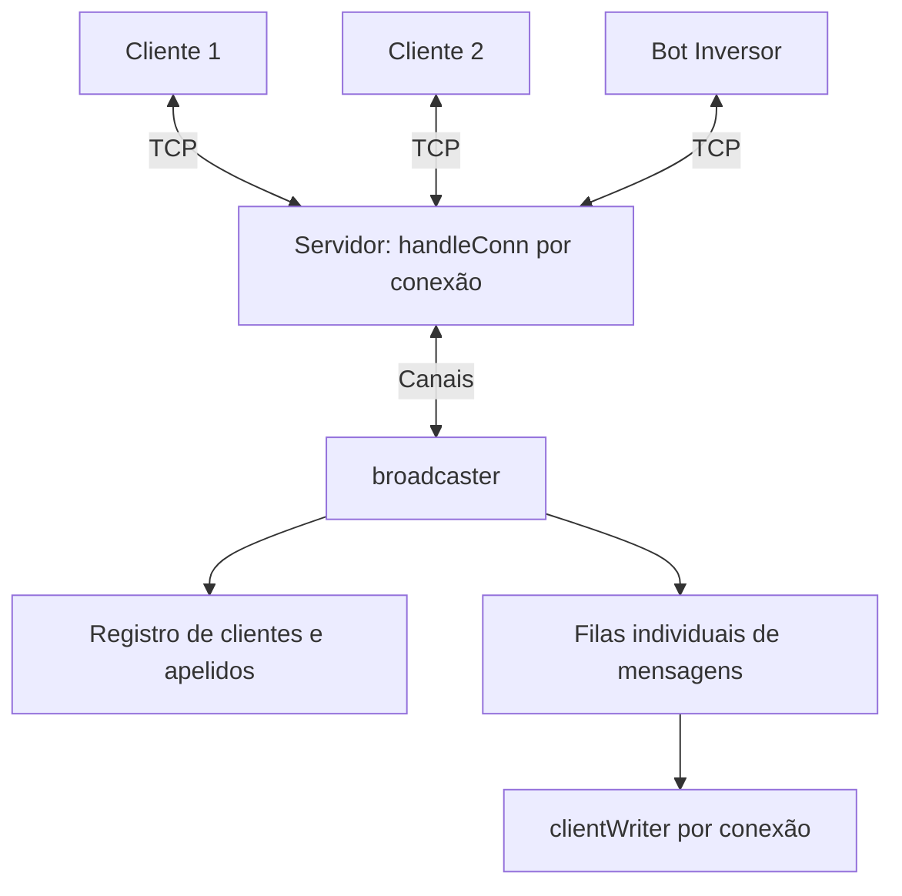

# EP03 — Chat Server em Go

Projeto da disciplina de **Paradigmas de Programação**: implementação de um chat de terminal com comunicação **TCP**, **gorrotinas** e **canais** da linguagem Go.

## Integrantes

- **Eduardo Leal Aruth**
- **Leonardo Rodrigues de Lima**
- **Yasmin Ayumi Foltran Mano**

## Objetivo

Desenvolver três programas independentes que se comuniquem pela porta TCP **4444**:

- **`server.go`** — aceita conexões simultâneas, registra apelidos, distribui mensagens públicas, encaminha mensagens privadas e anuncia entradas, saídas e mudanças de apelido.
- **`client.go`** — solicita um apelido, recebe mensagens e permite enviar comandos pelo terminal.
- **`bot.go`** — implementa o bot reativo **`@Inversor`**, que recebe mensagens privadas, inverte o texto e responde privadamente ao remetente.

Os exemplos iniciais fornecidos pelo professor foram preservados na pasta `base/`.

## Estrutura do projeto

```text
EP03-Paradigmas-Go/
├── server.go
├── client.go
├── bot.go
├── go.mod
├── README.md
└── base/
    ├── chat_server.go
    └── chat_client.go
```

> A pasta `base/` contém o código de referência da aula. Os três programas da entrega estão na raiz do projeto. Os nomes dos arquivos-base podem variar se os arquivos foram salvos com outro nome.

## Requisitos para executar

- Go instalado (o projeto declara **Go 1.26.8** em `go.mod`).
- Terminal local, como Ubuntu/WSL, Linux, macOS ou um terminal compatível no Windows.
- Porta TCP **4444** disponível.

O servidor escuta em `0.0.0.0:4444` e os programas cliente e bot se conectam a `localhost:4444`. Portanto, todos devem ser executados na mesma máquina para os comandos apresentados aqui.

Não há dependências externas além da biblioteca padrão de Go.

### Execução

Abra **três terminais** na pasta do projeto e execute **um programa por terminal**, nesta ordem:

**Terminal 1 — servidor**

```bash
go run server.go
```

**Terminal 2 — bot**

```bash
go run bot.go
```

**Terminal 3 — cliente**

```bash
go run client.go
```

O cliente solicitará um apelido. Para conectar outros usuários, abra mais terminais e execute `go run client.go` novamente, escolhendo apelidos diferentes.

> **Importante:** os três arquivos têm `package main` e sua própria função `main()`. Por isso devem ser executados ou compilados **individualmente** (`go run server.go`, por exemplo), e não com `go run .` ou `go build .`.

### Compilar separadamente (opcional)

```bash
go build -o server server.go
go build -o client client.go
go build -o bot bot.go
```

Em sistemas Unix, os executáveis resultantes podem ser iniciados com `./server`, `./bot` e `./client`, respectivamente. No Windows, ajuste o nome/extensão dos executáveis conforme necessário.

## Comandos do cliente

| Comando | Comportamento | Exemplo |
|---|---|---|
| `\changenick <apelido>` | Altera o apelido do usuário conectado. | `\changenick GatoPreto` |
| `\msg <mensagem>` | Envia uma mensagem pública a todos os **usuários** conectados. | `\msg Olá, pessoal!` |
| `\msg @<apelido> <mensagem>` | Envia uma mensagem privada somente ao destinatário. | `\msg @Leo Oi!` |
| `\exit` | Encerra a sessão do cliente. | `\exit` |

Os apelidos precisam ser únicos e não podem conter espaços ou `@`. Apelidos inválidos ou já utilizados são rejeitados.

## Exemplos de funcionamento

### Entrada de usuários e bots

Ao conectar um usuário chamado `Yasmin` e o bot `Inversor`, o servidor registra e anuncia aos usuários:

```text
Usuário @Yasmin acabou de entrar
Bot @Inversor acabou de entrar
```

### Mensagem pública

No cliente:

```text
\msg Olá, pessoal!
```

Os usuários conectados recebem:

```text
@Yasmin disse: Olá, pessoal!
```

**Bots não recebem mensagens públicas.**

### Mensagem privada e bot inversor

No cliente:

```text
\msg @Inversor abcdef
```

O bot identifica o remetente, imprime a mensagem e sua resposta:

```text
Mensagem de: @Yasmin
Recebi: abcdef
Resposta: fedcba
```

O cliente recebe somente a resposta privada:

```text
@Inversor disse em privado: fedcba
```

A inversão usa `[]rune`, permitindo lidar com caracteres Unicode, como letras acentuadas. Por exemplo, `concorrência` é invertido para `aicnêrrocnoc`.

### Troca de apelido e saída

```text
\changenick Teste
Usuário @Yasmin agora é @Teste

\exit
Saindo do chat...
```

O servidor anuncia aos demais usuários:

```text
Usuário @Teste saiu
```

Quando o bot desconecta, o servidor registra a saída como `Bot @Inversor saiu`.

## Arquitetura e concorrência

A comunicação utiliza **TCP**, com uma conexão por participante. O servidor cria uma gorrotina `handleConn()` para cada nova conexão aceita e outra gorrotina `clientWriter()` para escrever as mensagens de saída daquela conexão.



### Responsabilidades

- **`handleConn()`**: identifica o participante com `NICK <apelido>` ou `BOT <apelido>`, interpreta comandos e solicita operações por canais.
- **`broadcaster()`**: centraliza os mapas de participantes e apelidos, processa entradas, saídas, trocas de apelido e roteamento de mensagens.
- **`clientWriter()`**: consome a fila individual de saída e escreve no socket TCP.
- **`client.go`**: usa gorrotinas para receber mensagens e ler o teclado; um `select` permite reagir tanto a comandos locais quanto ao encerramento da conexão.
- **`bot.go`**: lê apenas mensagens privadas no formato esperado, inverte seu conteúdo e envia a resposta ao remetente.

### Canais utilizados no servidor

| Canal | Finalidade |
|---|---|
| `entering` | Solicitar o cadastro de uma conexão e verificar se o apelido está livre. |
| `leaving` | Solicitar a remoção de um participante e confirmar o fechamento de sua fila. |
| `messages` | Encaminhar anúncios e mensagens públicas aos usuários. |
| `trocasApelido` | Solicitar uma mudança de apelido, validada pelo servidor. |
| `mensagensPrivadas` | Localizar um destinatário e encaminhar somente a ele a mensagem privada. |

Cada participante registrado possui um canal de saída `mensagens` com buffer de **32 mensagens**. Os mapas de clientes e apelidos são manipulados dentro do `broadcaster()`, evitando acesso simultâneo direto a esses mapas por várias gorrotinas.

O servidor também utiliza `writerDone` para sinalizar o encerramento da escrita e um prazo de **5 segundos por operação de escrita TCP**. Ao desconectar, `handleConn()` solicita a remoção pelo canal `leaving` e aguarda sua confirmação.

## Protocolo de comunicação

Os programas usam um protocolo de texto baseado em linhas (`\n`):

1. A primeira linha enviada pelo cliente identifica o usuário: `NICK Yasmin`.
2. A primeira linha enviada pelo bot identifica o agente: `BOT Inversor`.
3. Depois do registro, as linhas podem conter comandos como `\msg` e `\changenick`.
4. O servidor formata as respostas para exibição no terminal, distinguindo anúncios, mensagens públicas e mensagens privadas.

O servidor valida apelidos repetidos e comandos de mensagem vazios, além de informar quando um destinatário não existe ou está indisponível.

## Testes e verificações

Durante o desenvolvimento, foram executados testes manuais com servidor, clientes e bot em terminais independentes. Os cenários verificados incluíram:

- conexão simultânea de usuários e bot;
- mensagens públicas visíveis aos usuários e não processadas pelo bot;
- mensagens privadas encaminhadas somente ao destinatário;
- resposta do bot com texto invertido, inclusive com acentos;
- troca de apelido e reconhecimento do apelido novo pelo bot;
- rejeição de apelidos duplicados ou inválidos;
- erro ao enviar mensagem privada para destinatário inexistente;
- saída com `\exit` e aviso de desconexão;
- encerramento automático do cliente quando o servidor é interrompido.

Também foram executados os programas com o detector de corridas do Go, sem avisos `WARNING: DATA RACE` **nos cenários observados**:

```bash
go run -race server.go
go run -race bot.go
go run -race client.go
```

Execute cada comando em um terminal separado. A ausência de alertas nessas execuções não constitui garantia de ausência de todas as condições de corrida ou de problemas sob carga.

## Limitações conhecidas

- O sistema foi projetado para **uso local** e emprega host e porta fixos, conforme o enunciado.
- Se a fila de um destinatário estiver cheia, uma mensagem pública pode ser descartada para esse cliente lento; o servidor registra essa situação em log.
- Para mensagens privadas, o servidor informa falha quando não consegue enfileirar a mensagem, mas a inclusão na fila **não garante** que ela tenha sido efetivamente recebida ou lida pelo destinatário.
- Não há persistência de histórico, autenticação ou criptografia das mensagens, pois esses recursos não fazem parte do escopo solicitado.
- Os testes realizados cobrem os fluxos principais; não substituem testes de estresse ou uma verificação exaustiva de desconexões excepcionais.

## Referência da atividade

Implementação baseada nos arquivos de exemplo `chat_server.go` e `chat_client.go` fornecidos na disciplina de Paradigmas de Programação. Os programas da entrega foram desenvolvidos separadamente, mantendo os exemplos originais na pasta `base/`.